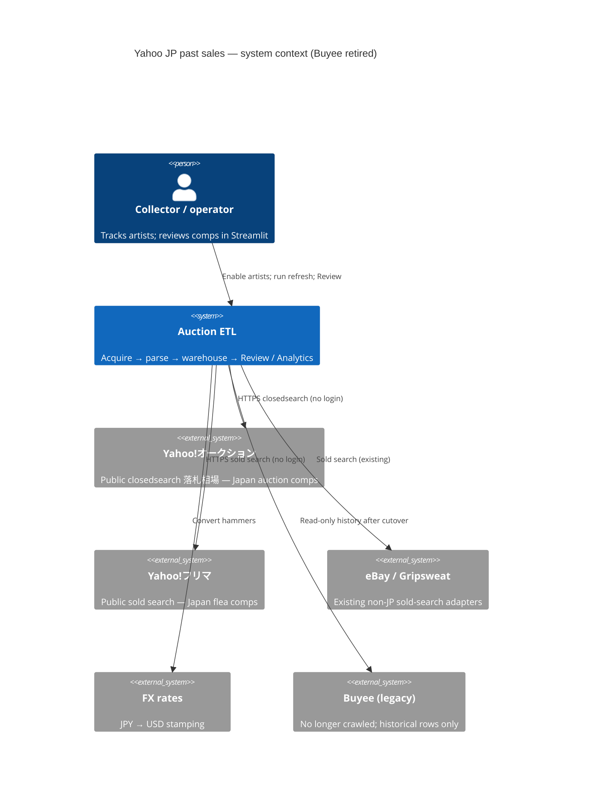
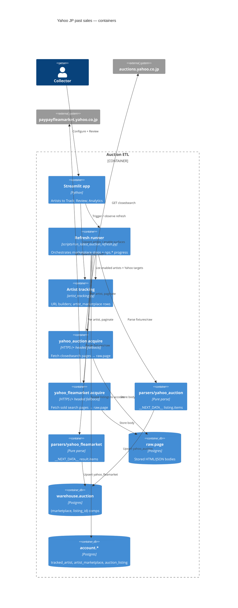
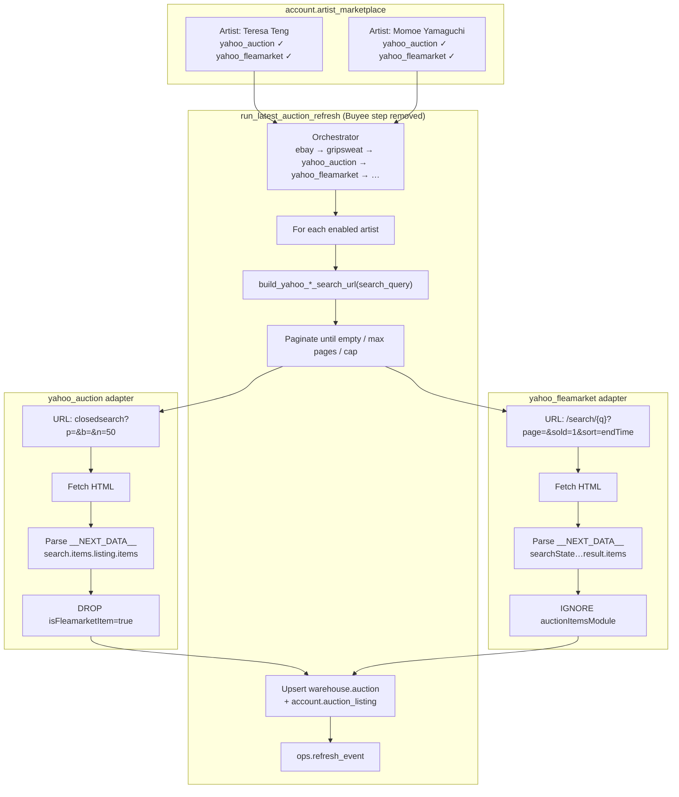

# Yahoo Japan past sales (Auctions closedsearch + フリマ sold)

Date: 2026-11-16 (expanded 2026-11-18; Approach A + Buyee retirement)  
Status: **design locked (Approach A + Buyee retirement); Slice 1 started** — fixtures + URL builders + parsers under test; warehouse/refresh/UI not wired yet  
ADR: `docs/ADR-2026-11-19-yahoo-jp-replace-buyee-comps.md` (Buyee watched-only → Yahoo public comps; layout + rate budgets + integration gates)

## Problem

Today Japan JPY sales enter the warehouse mainly through **Buyee closed watchlist**. That path is narrow (only auctions the operator already watched), fragile (login + headed owner + WAF), and misses the bulk of Teresa Teng / Momoe Yamaguchi comps that sit on public Yahoo Japan search.

Public past-sale surfaces already exist and take the same keyword pattern as eBay sold search:

| Surface | Example URL | Role |
|---|---|---|
| Yahoo!オークション 落札相場 | `https://auctions.yahoo.co.jp/closedsearch/closedsearch?va=teresa+teng&vo=&ve=&auccat=0&aucminprice=&aucmaxprice=&slider=0&ei=UTF-8&f_adv=1&fr=auc_adv&b=1&n=50` | Closed auction / fixed-price hammers |
| Yahoo!フリマ sold | `https://paypayfleamarket.yahoo.co.jp/search/teresa%20teng?page=1&sold=1&sort=endTime&order=DESC` | Peer sold (`itemStatus: SOLD`) listings |

**Product decision:** **Approach A**, and these two public surfaces **replace Buyee** as the Japan JPY comps ingest path. Buyee watchlist crawl is **retired** once Yahoo Auctions + フリマ refresh is production-grade — not kept as a parallel Japan source.

**Auth contrast vs Buyee (why retirement is viable):** both Yahoo surfaces are **public**. Live `__NEXT_DATA__` shows `shouldLogin: false` / no Passport gate. Refresh does **not** need a logged-in Buyee owner for search. (Headed Chrome remains a WAF fallback only.)

Yahoo Taiwan past sales are unavailable for this product. Yahoo!ショッピング is storefront inventory, not a comps feed — out of scope here. Discogs API does **not** expose per-release sold history; Discogs stays identity-only.

## Goal

Japan past sales come from **Yahoo Auctions closedsearch + Yahoo フリマ sold**, driven by tracked artists the same way eBay uses `build_ebay_search_url(artist_name)`. Buyee is no longer the Japan feed.

Success when implemented later:

1. Add/enable artist → `yahoo_auction` and/or `yahoo_fleamarket` get `search_query` / `search_url` (per-surface enable).
2. Multi-artist accounts (Momoe **and** Teresa) each get their own URL pair; refresh walks **artists × enabled Yahoo marketplaces**.
3. Refresh upserts `(marketplace, listing_id)` with JPY hammers and end times into the same warehouse / Review pipeline as eBay.
4. Review shows **Yahoo Auctions** / **Yahoo フリマ** chips as the Japan sources.
5. **Buyee refresh step is turned off** (and owner/login path can be decommissioned); historical Buyee warehouse rows remain readable but are not freshly crawled.
6. No Discogs sales scrape.

**Scraper bar (higher than a side-channel):** because these adapters **are** the Japan path, they must be production-shaped from day one — stable URL builders, pinned pagination/sort, `__NEXT_DATA__` parsers with fixtures, cross-surface contamination filters, per-host pacing, page caps, fail-closed on empty/challenge pages, and doctor/refresh isolation — not a brittle one-off scrape next to Buyee.

## Non-goals (this design)

- Implementing crawlers, parsers, or UI in this change set (design only).
- Yahoo Taiwan, Yahoo Shopping, Mercari, Rakuten.
- Reviving Buyee artist-search / beyond-watchlist (Buyee is exiting, not expanding).
- Discogs `/sell/history` scraping or API past-sales (API cannot do it).
- Redesigning Streamlit performance (separate track).
- Deleting historical `marketplace=buyee` warehouse rows (keep for lineage; stop refresh).

## Approaches considered

| | Approach | Pros | Cons |
|---|---|---|---|
| **A (chosen)** | Two warehouse marketplaces: `yahoo_auction` and `yahoo_fleamarket`, each with its own URL builder + parser + refresh step, driven by the same tracked-artist name; **Buyee Japan ingest retired** once both are live | Clear IDs; mirrors eBay vs Gripsweat; matches real site split; ends login/WAF Buyee dependency | Two adapters to maintain; must migrate Review/doctor expectations off Buyee |
| B | One `yahoo_jp` marketplace with `channel` in `config_json` | Fewer labels in UI | Muddy identity; harder doctor/refresh state |
| C | Auctions only; フリマ “later”; keep Buyee meanwhile | Smaller first slice | Leaves フリマ on the table; prolongs Buyee dual-run |

**Choice: A.** Same artist keyword, two marketplace keys — like eBay + Gripsweat. Scraping logic **differs** (URL shape, pagination, parse path), so do not blend feeds. Buyee is a **cutover**, not a third permanent Japan adapter.

---

## C4 views

### Level 1 — System context

What sits around Auction ETL when Yahoo JP past sales are in play.



### Level 2 — Containers



### Level 3 — Refresh / acquire / parse components (multi-artist)



---

## Design

### 1. Keyword → URL (same vibe as eBay; two builders)

Extend `account.artist_marketplace` so a tracked artist can enable:

| marketplace | Builder | First page | Next pages |
|---|---|---|---|
| `yahoo_auction` | `build_yahoo_auction_search_url(query, *, start=1, page_size=100)` | Advanced `…/closedsearch/closedsearch?va={q}&f_adv=1&fr=auc_adv&b=1&n=100` (same hits as older `p=` links) | `b = 1 + (page_index * n)` → page 2 is `b=101` when `n=100` |
| `yahoo_fleamarket` | `build_yahoo_fleamarket_search_url(query, *, page=1)` | `…/search/{path_q}?page=1&sold=1&sort=endTime&order=DESC` | `page=2,3,…` (100 results/page observed) |

Wire into `upsert_account_artist` the same way eBay/Gripsweat are wired today (`build_ebay_search_url` / `build_gripsweat_search_url`).

#### Encoding rules (pinned from live checks)

| Surface | Query placement | Encoding | Notes |
|---|---|---|---|
| Auctions | Query string `p=` | `quote_plus` → spaces as `+` (ASCII) or percent-encoded UTF-8 for Japanese | Works for `teresa+teng`, `%E5%B1%B1%E5%8F%A3%E7%99%BE%E6%81%B5` (山口百恵), `%E3%83%86%E3%83%AC%E3%82%B5%E3%83%BB%E3%83%86%E3%83%B3` (テレサ・テン) |
| フリマ | **Path segment** `/search/{q}` | Path-encode spaces as `%20` (not `+`); Japanese as UTF-8 percent | `sold=1` required for past sales; without it you get active inventory |

#### Canonical examples (Teresa / Momoe)

```
# yahoo_auction — Teresa Teng (Latin)
https://auctions.yahoo.co.jp/closedsearch/closedsearch?p=teresa+teng&fixed=0&b=1&is_postage_mode=1&n=50
# page 2
https://auctions.yahoo.co.jp/closedsearch/closedsearch?p=teresa+teng&fixed=0&b=51&is_postage_mode=1&n=50

# yahoo_auction — Momoe (Japanese)
https://auctions.yahoo.co.jp/closedsearch/closedsearch?p=%E5%B1%B1%E5%8F%A3%E7%99%BE%E6%81%B5&fixed=0&b=1&is_postage_mode=1&n=50

# yahoo_fleamarket — Teresa Teng (prefer endTime sort for stable paging)
https://paypayfleamarket.yahoo.co.jp/search/teresa%20teng?page=1&sold=1&sort=endTime&order=DESC
# page 2
https://paypayfleamarket.yahoo.co.jp/search/teresa%20teng?page=2&sold=1&sort=endTime&order=DESC
```

#### Fixed query params (product defaults)

| Param | Surface | Value | Why |
|---|---|---|---|
| `fixed` | auction | `0` | Include both auction and fixed-price closed lots (matches today’s operator URL) |
| `is_postage_mode` | auction | `1` | Keep parity with the proven closedsearch link |
| `n` | auction | `100` | Page size; also drives `b` arithmetic |
| `sold` | flea | `1` | Past sales only |
| `sort` / `order` | flea | `endTime` / `DESC` | Newest sold first; **stable pagination** (default `ranking` overlapped ~26/100 ids across page 1→2 in live check) |

- `search_query` defaults to the tracked artist display name (operator can override later, same as eBay).
- Optional category filters (レコード / CD) stay **off** by default so titles that sit in odd categories still appear; tighten later if noise is high.
- Closedsearch already expands Latin queries server-side (e.g. `teresa teng` → also テレサ / 鄧麗君 in `queryEx`); still allow a Japanese `search_query` override when Latin recall is weak.

### 2. Page layout and parse contract (live 2026-11-18)

Both hosts are Next.js apps. Prefer parsing embedded `__NEXT_DATA__` over brittle CSS selectors. Keep HTML fixtures so layout drift is recoverable.

#### 2a. Yahoo Auctions closedsearch

| Aspect | Observation |
|---|---|
| Auth | Public; no Buyee-style login |
| Page shell | Next route `/closedsearch/closedsearch/[[...params]]` |
| Result list | `__NEXT_DATA__.props.pageProps.initialState.search.items.listing.items` |
| Page size | `n` (default 50); `listing.totalResultsAvailable` (e.g. Teresa ~4131, Momoe ~6938) |
| Pagination | `b` = 1-based start index; page *k* → `b = 1 + (k-1)*n`; page 1∩2 auction ids = **0** in live check |
| Stop when | `items` empty **or** `b > totalResultsAvailable` **or** hit per-artist page cap |

**Card fields to map into warehouse** (from listing item JSON):

| Warehouse-ish field | JSON path / rule |
|---|---|
| `listing_id` | `auctionId` (e.g. `p1252469501`) |
| `title` | `title` |
| Hammer JPY | `price` (integer yen) |
| `closing_at` | `endTime` (ISO-8601 with `+09:00`) |
| Started | `startTime` (optional) |
| Image | `imageUrl` |
| Seller | `seller.userId` (displayName often masked `********`) |
| Condition | `itemCondition` (e.g. `USED10`) |
| Fixed-price flag | `isFixedPrice` (keep; still a closed sale) |
| URL | `https://auctions.yahoo.co.jp/jp/auction/{auctionId}` |

**Cross-surface contamination (must handle):** listing items can have `isFleamarketItem: true` (5/50 on Teresa page 1). Those also appear as フリマ-style links in the HTML. **`yahoo_auction` parser must drop `isFleamarketItem` rows** so the same physical channel is not double-ingested under the wrong marketplace key.

#### 2b. Yahoo フリマ sold search

| Aspect | Observation |
|---|---|
| Auth | Public; `app.shouldLogin: false` |
| Page shell | Next + `__NEXT_DATA__` |
| Result list | `props.initialState.searchState.search.result.items` |
| Filters in state | `searchParams.itemStatus: "sold"` when `sold=1` |
| Page size | 100 (`totalResultsReturned`); `totalResultsAvailable` e.g. Teresa ~415 → ~5 pages |
| Pagination | `page` query param; internal `offset = (page-1)*100` |
| Sort | **Require** `sort=endTime&order=DESC` in builder (see above) |
| Stop when | empty `items` **or** `offset >= totalResultsAvailable` **or** page cap |

**Card fields:**

| Warehouse-ish field | JSON path / rule |
|---|---|
| `listing_id` | `id` (mixed prefixes: `z…`, `w…`, etc. — do not assume one letter) |
| `title` | `title` |
| Hammer JPY | `price` |
| `closing_at` / sold_at | Prefer `endTime`; `openTime` also present |
| Status guard | Require `itemStatus == "SOLD"` (page 1 was 100/100 SOLD with `sold=1`) |
| Image | `thumbnailImageUrl` |
| Seller | `sellerId` / nested `seller` |
| Condition | `condition` (e.g. `used20`) |
| URL | `https://paypayfleamarket.yahoo.co.jp/item/{id}` |

**Cross-surface contamination:** the same page embeds `auctionItemsModule.items` (live auction promos). **Ignore that module entirely** — only parse `result.items`.

### 3. Identity and money

| Field | `yahoo_auction` | `yahoo_fleamarket` |
|---|---|---|
| `marketplace` | `yahoo_auction` | `yahoo_fleamarket` |
| `listing_id` | `auctionId` | フリマ `id` |
| Currency | JPY | JPY |
| Hammer | `price` | `price` |
| `closing_at` | `endTime` | `endTime` |
| `auction_url` | `…/jp/auction/{id}` | `…/item/{id}` |
| Title / seller / image | From search JSON; detail page optional | Same |

Identity is native Yahoo (`auctionId` / flea `id`). Do **not** invent Buyee proxy ids for new rows. Historical `marketplace=buyee` rows may still exist; Review may optionally soft-link them to `yahoo_auction` by shared Yahoo auction id during cutover, then treat Yahoo as canonical for Japan comps.

Labels already stubbed in Review support: `yahoo_auction` / `yahoo_fleamarket` → **Yahoo Auctions** / **Yahoo フリマ**.

### 4. Multi-artist refresh loop (eBay-parallel)

Today eBay/Gripsweat work like this:

1. Operator adds **one artist at a time** (`upsert_account_artist`) with marketplace checkboxes.
2. Each artist gets an `artist_marketplace` row per surface with `search_query` + `search_url`.
3. Refresh loads enabled artists and, for each enabled target, fetches that artist’s URL.

Yahoo follows the **same** pattern — **not** one combined query for “Momoe OR Teresa”:

| Operator action | Stored rows |
|---|---|
| Add “Teresa Teng” with Yahoo Auctions + フリマ | 2 rows: `yahoo_auction`, `yahoo_fleamarket` |
| Add “Momoe Yamaguchi” with both | 2 more rows |
| Pause one artist | `tracked_artist.enabled = false` → both Yahoo steps skip that artist |
| Disable only フリマ for Momoe | that `artist_marketplace.enabled = false` |

Pseudo-orchestration:

```
for marketplace in (yahoo_auction, yahoo_fleamarket):
  for artist in enabled_artists_with(marketplace):
    url0 = builder(artist.search_query)
    for page in 1..max_pages:
      body = acquire(url_for_page)
      rows = parse(body)  # marketplace-specific
      upsert(rows)
      if should_stop(rows, totals): break
```

Failure isolation: one artist or one Yahoo surface failing must not skip the other surface or wipe baseline counts (same doctor invariants as eBay).

### 5. Acquire / parse / store (shared product pattern)

Follow [`ENGINEERING.md`](../../ENGINEERING.md) §4:

1. **Acquire** search HTML → `raw.page` (or existing raw store).
2. **Parse** pure functions over fixtures (`parsers/yahoo_auction.py`, `parsers/yahoo_fleamarket.py`) reading `__NEXT_DATA__`.
3. **Upsert** `warehouse.auction` on `(marketplace, listing_id)`.
4. **Scope** into `account.auction_listing` for the account that tracked the artist.
5. **Enrich** optional: item detail; FX to USD via existing FX path.

**Browser posture:**

- Prefer **HTTPS first** (proven 200 on both example URLs without cookies/login).
- If WAF / empty / challenge: fall back to **headed Chrome** (shared pattern with eBay), off-desktop window placement — **not** the Buyee logged-in owner.
- Do not use true headless.
- **No Buyee credentials** in the steady state; retiring Buyee means the Japan path must stand on public Yahoo alone.

**Retention windows (product expectations, not hard deletes):**

- Auctions closedsearch: on the order of **~120 days** of public history (community scrape notes; re-verify at implement).
- フリマ SOLD search: public SOLD display on the order of **~180 days** after sale ([Yahoo!フリマ notice](https://paypayfleamarket.yahoo.co.jp/notice/function/post_1116/)).
- Warehouse rows **stay** after they fall off the public window; refresh only stops seeing new/changed cards.

### 6. Dedupe and Review

| Pair | Rule |
|---|---|
| `yahoo_auction` ↔ legacy Buyee | During cutover: same Yahoo auction id → **one** unique sale; prefer **Yahoo Auctions** as canonical once crawl is live. After Buyee refresh is off, stop minting Buyee rows; keep old Buyee rows visible as history or fold into Yahoo identity in Review. |
| `yahoo_auction` ↔ `yahoo_fleamarket` | Different sites; **no** automatic merge (drop `isFleamarketItem` from auction parse; ignore flea’s auction module). |
| `yahoo_*` ↔ eBay / Gripsweat | No merge; different market. |
| Same title, different ids | Two rows (correct market history), same as today. |

Japan source chips in Review: **Yahoo Auctions** / **Yahoo フリマ** (Buyee chip becomes legacy-only).

### 7. Refresh orchestration + Buyee cutover

Target steady-state runner (names illustrative):

`… → ebay → gripsweat → yahoo_auction → yahoo_fleamarket → fx → doctor → …`

**Cutover plan:**

| Phase | Behavior |
|---|---|
| Dual-run (short) | Yahoo steps on; Buyee step still runs; Review dedupes auction-id overlap preferring Yahoo |
| Cutover | Disable Buyee marketplace step + owner jobs; doctor baselines switch to Yahoo JP counts |
| Retired | Buyee acquire/owner not started by refresh; docs/RUNBOOK point at Yahoo surfaces |

- Artists to Track UI: Yahoo Auctions / Yahoo フリマ checkboxes (replace Buyee as the Japan toggles).
- Extend `SUPPORTED_MARKETPLACES` + URL builder branch in `upsert_account_artist` (today only eBay vs Gripsweat).

### 8. Rate, pacing, and politeness

- Pace per host (separate budgets for `auctions.yahoo.co.jp` vs `paypayfleamarket.yahoo.co.jp`).
- Cap pages per artist per refresh (start conservative — e.g. first 3–5 pages newest-first; Teresa auction alone is 80+ pages at `n=50`).
- Store raw HTML so selector/`__NEXT_DATA__` shape breakage is fixable offline.

### 9. Testing before any production crawl

1. Save fixture HTML from the two example URLs (Teresa Teng) plus one Momoe closedsearch query; include flea page 2 with `sort=endTime`.
2. Parser unit tests: listing_id, title, JPY hammer, end/sold time, url; assert flea-in-auction rows dropped; assert auction module ignored on flea.
3. URL builder tests: artist name → exact query substitution; `b=` / `page=` pagination; flea `%20` path encoding; Japanese queries.
4. Multi-artist tests: two enabled artists → two URL sets; disabled marketplace skipped.
5. Cutover tests: legacy Buyee + new `yahoo_auction` same id → one Review sale (Yahoo preferred).
6. No live scrape required for merge of the design implementation PR until fixtures pass.

### 10. Product UI overhaul — Refresh + Review graphs

The Japan source change is not backend-only. **Refresh marketplace sales** and **Review marketplace sales** still hard-code the three-source world (`Buyee` / `eBay` / `Gripsweat`). That breakdown and the ingestion graph must move with Approach A + Buyee retirement.

#### Steady-state source set

| Role | Marketplace keys | Customer labels |
|---|---|---|
| Japan auction comps | `yahoo_auction` | Yahoo Auctions |
| Japan flea comps | `yahoo_fleamarket` | Yahoo フリマ |
| US/archive | `ebay`, `gripsweat` | eBay, Gripsweat |
| Legacy only | `buyee` | Buyee (history; not refreshed) |

#### Surfaces to update together

| Surface | Today | After |
|---|---|---|
| Refresh caption / “all three marketplaces” copy | Buyee+eBay+Gripsweat | eBay+Gripsweat+Yahoo Auctions+Yahoo フリマ (Buyee dropped after cutover) |
| Refresh **What came in** bar chart | `y=["Buyee","eBay","Gripsweat"]` via `reporting/ingestion_activity.MARKETPLACES` | Chart columns = steady-state labels; map `yahoo_auction` / `yahoo_fleamarket` in `_marketplace_label` |
| Refresh marketplace progress cards | Buyee / eBay / Gripsweat steps | Replace Buyee card with Yahoo Auctions + Yahoo フリマ (or dual-run then swap) |
| **Scraping modality legend** (new) | Implicit | Explicit breakdown next to the graph — see below |
| Review `SOURCE_ORDER` / unique-sale metrics | `("Buyee","eBay","Gripsweat")` | `("Yahoo Auctions","Yahoo フリマ","eBay","Gripsweat")` (+ optional legacy Buyee bucket during dual-run) |
| Review / Analytics captions (“Buyee, eBay, and Gripsweat on one chart”) | Three sources | Four live sources; Buyee only if legacy rows remain |
| Home / nav brand note | “Buyee, eBay, and Gripsweat” | Japan = Yahoo Auctions + フリマ; plus eBay + Gripsweat |
| Artists to Track | eBay / Gripsweat toggles | Add Yahoo Auctions / Yahoo フリマ; remove or gray Buyee |

#### Scraping-type breakdown (show on Refresh)

Operators need to see **how** each feed is scraped, not only counts:

| Marketplace | Modality | Auth | Notes |
|---|---|---|---|
| Yahoo Auctions | HTTPS search → `__NEXT_DATA__` parse | None | Headed Chrome only if WAF |
| Yahoo フリマ | HTTPS search → `__NEXT_DATA__` parse | None | Same; pin `sort=endTime` |
| eBay | Headed Chrome sold search | Session/profile as today | Unchanged |
| Gripsweat | HTTPS search | None | Unchanged |
| Buyee (retired) | ~~Headed owner + login watchlist~~ | ~~Buyee login~~ | Removed from refresh after cutover |

Render this as a small legend/table under the ingestion graph on **Refresh marketplace sales** (and optionally a one-line caption on Review). The graph answers “how many”; the legend answers “what kind of scrape.”

### 11. Docker + one-command bootstrap (already in repo)

| Piece | Status | Role for Yahoo scrapers |
|---|---|---|
| `compose.auction-etl.yml` + `Dockerfile.auction-etl` | Present | UI + Postgres (`db` + `collector`) |
| `compose.auction-etl.refresh.yml` + `Dockerfile.auction-etl.refresh` | Present | Refresh worker image (Playwright path for headed fallbacks) |
| `./scripts/start-local.sh` | Present — **one-command local UI** | Ensures Colima Postgres on `:5544`, HTTPS Streamlit on `:8501` |
| Refresh CLI | `scripts/run_latest_auction_refresh.py` | Extend with Yahoo steps; same `DATABASE_URL` contract |

No new bootstrap invention required for the first Yahoo slices: develop/test parsers against fixtures in the existing venv; run acquire against live Yahoo over HTTPS from the host or refresh container. Document in RUNBOOK that Japan ingest no longer needs Buyee login cookies after cutover.

### 12. Tax / money fields (comps scrape — locked from live UI)

We only scrape **price facts** for comps (not Buyee proxy fees). Warehouse mapping:

| Field | Yahoo Auctions | Yahoo フリマ |
|---|---|---|
| `gross_price` | Displayed hammer (税込 when taxed) | Sold `price` |
| `final_price` | After-tax-adjusted hammer (ex-tax) | Same as sold `price` |
| `tax_amount` | `gross - final` when taxed; `0` when UI shows Tax 0 yen | `NULL` (no tax signal) |
| `price_includes_tax` | `true` / `false` | `NULL` |
| `start_price` | `initPriceNoTax` / detail `initPrice` | `NULL` |
| `bid_count` | `bidCount` | `NULL` |

**Auctions (matches screenshot `p1252469501`: 43,018 yen + “(Tax 0 yen)” + 27 bids + start 15,000):**

- `taxFlag=0` → gross=final=`price`, tax=0, includes=false.
- `taxFlag=1` → gross=`price` (税込); final=`price/1.1` (or `initPriceNoTax` only when it matches that within ¥1 — fixed-price cards). Never treat a ¥1 start as the adjusted hammer.

**フリマ sold search** (`…/search/teresa%20teng?page=1&sold=1&sort=endTime&order=DESC`): search + item detail samples expose **no** tax / 税込 fields — store hammer only; do **not** invent 10/110.

**Closedsearch URL:** operator advanced form `va=` (+ `f_adv=1&fr=auc_adv`) is canonical in the builder; same result set as older `p=` links; paginate with `b=` / `n=`.

**Pre-integration live gate (required before Refresh / Review UI):**

```bash
# 100 listings/page; detail-check every scraped card (both hosts)
.venv/bin/python scripts/verify_yahoo_jp_scrape.py \
  --query 'teresa teng' --target 100 --page-size 100 --detail-sample 0 \
  --json-out reports/yahoo-jp-live-verify.json \
  --listing-proof-out reports/yahoo-jp-listing-proofs.json
```

Checks (not just HTTP 200): `n=100` paging, **every** search-card title/url/close/money, plus **per-listing item detail** (search↔detail id/price/tax). Writes proof JSON; no warehouse rows by itself. Live status: Auctions **100/100 detail PASS**; フリマ search 100 OK — detail re-check if PayPay returns 429.

**UI wiring (started):** Review `SOURCE_ORDER` includes Yahoo Auctions / Yahoo フリマ; Buyee twins of Yahoo auction ids are dropped; Refresh ingestion chart maps `yahoo_*`; migration `d5e8f2a1b903` allows those marketplace keys on `account.auction_listing`. Refresh runner steps / Artists-to-Track toggles / Buyee retirement still follow.
### 13. Buyee ↔ Yahoo identity (authoritative source — same pattern as eBay/Gripsweat)

Buyee is a **proxy** for Yahoo Auctions (`buyee.jp/item/jdirectitems/auction/{id}`). Local warehouse evidence (2026-11-18):

| Fact | Evidence |
|---|---|
| Buyee `listing_id` shape | Mostly `letter+digits` (950) plus some digits-only (41) — same shape as Yahoo `auctionId` |
| Buyee URL | Always Buyee host; path ends with that same id (not `auctions.yahoo.co.jp`) |
| Live overlap | Teresa closedsearch fixture page ∩ Buyee warehouse already shares at least one id (`r1251679344`) |
| フリマ | Different id space (`z…`, `w…`, …) and host; **not** the Buyee auction-proxy path — **no** auto-merge with Buyee/`yahoo_auction` |

**Rule (mirror `drop_overlapping_gripsweat_rows`):** when `buyee.listing_id == yahoo_auction.listing_id`, that is **one** physical auction. Unique-sale views keep **one** row.

| Phase | Authoritative row | Other row |
|---|---|---|
| Dual-run (Yahoo newly wired, Buyee still refreshing) | **Yahoo Auctions** (native comps URL, public search) | Hide Buyee twin from unique-sale counts/charts (keep warehouse row) |
| After Buyee retired | **Yahoo Auctions** only for new Japan auction comps | Legacy Buyee rows: still dedupe if id matches; no new Buyee crawl |
| フリマ vs anything | Always its own sale | Never collapse on title alone |

This is **not** the eBay OBO/Gripsweat money special-case. It is pure **same-listing identity** (like Gripsweat dropping when the eBay item number already exists). Digits-only Buyee ids must normalize the same way Yahoo exposes them (confirm in real-data tests — do not zero-pad or invent a letter prefix).

**Investigation checklist (must pass before dual-run UI claims “no doubles”):**

1. Script: for every `marketplace=buyee` id, HTTPS GET `https://auctions.yahoo.co.jp/jp/auction/{id}` (or parse closedsearch hits) → count 200 vs 404.
2. Compare title/price/endTime on matches (tolerance for FX/proxy markup on Buyee card vs Yahoo hammer).
3. Unit test: synthetic Buyee + `yahoo_auction` same id → Review unique-sale frame length 1, label Yahoo Auctions.
4. Prove フリマ id never equals a Buyee auction id in warehouse (or document rare collisions if any).

### 14. Real-data test plan (parity with eBay / Buyee / Gripsweat)

Fixture unit tests (Slice 1) are necessary but **not** sufficient. Existing platforms were proven with live warehouse ingest + Refresh/Review. Yahoo must get the same bar.

#### A. Offline (CI) — already started

| Test | Pass bar |
|---|---|
| URL builders | Teresa/Momoe Latin+Japanese; `b=` / `page=`; flea `sold=1&sort=endTime` |
| closedsearch parser | ≥40 auction rows; **0** `isFleamarketItem`; ids/prices/endTimes |
| flea parser | 100 SOLD; ignore auction module; no invented tax |
| Detail tax samples | tax0 plain vs tax1 `taxinPrice` |

#### B. Live acquire smoke (host or refresh container — no warehouse yet)

| Step | Pass bar |
|---|---|
| HTTPS GET closedsearch Teresa p1 + p2 (`b=51`) | 200; parse_ok; page id sets disjoint |
| HTTPS GET closedsearch Momoe Japanese | 200; non-empty |
| HTTPS GET flea Teresa `sort=endTime` p1 + p2 | 200; disjoint ids; all SOLD |
| Challenge/empty HTML | fail-closed (0 upserts, logged), not silent success |
| Optional headed fallback | Only if HTTPS challenged |

#### C. Warehouse wiring (real data into `auction_warehouse`)

| Step | Pass bar |
|---|---|
| Upsert N pages for 2 artists (Teresa + Momoe) × 2 Yahoo markets | Rows in `warehouse.auction` with `yahoo_auction` / `yahoo_fleamarket` |
| Idempotent re-run | Same `(marketplace, listing_id)` — update in place, no duplicates |
| Account scope | Visible under signed-in account like eBay |
| Doctor / refresh_event | Per-marketplace counts move; one Yahoo failure does not wipe the other |
| Buyee∩Yahoo id report | Print overlap count; unique-sale query shows **one** row per shared id |

#### D. UI wiring — all platforms visible together

| Surface | Pass bar |
|---|---|
| Refresh marketplace sales | Progress cards + **What came in** chart include Yahoo Auctions + Yahoo フリマ; Buyee removed after cutover (dual-run: show all five briefly or Yahoo+legacy) |
| Scraping modality legend | HTTPS Yahoo ×2, headed eBay, HTTPS Gripsweat, Buyee retired/struck |
| Review unique-sale metrics/chart | `SOURCE_ORDER` = Yahoo Auctions, Yahoo フリマ, eBay, Gripsweat (+ legacy Buyee only if still counted pre-cutover) |
| Artists to Track | Enable Yahoo toggles; multi-artist refresh uses both |
| Analytics “one chart” copy | Mentions Yahoo JP surfaces instead of Buyee |

#### E. Buyee retirement gate (official — “for good”)

Retire Buyee refresh/owner **only when all are true**:

1. C + D green for both Yahoo adapters on tracked artists (Teresa + Momoe minimum).
2. Identity tests (§13) green — no double unique sales for shared auction ids.
3. One full `run_latest_auction_refresh` without Buyee step (feature-flagged) matches doctor expectations.
4. RUNBOOK/ENGINEERING point at Yahoo; Buyee owner not started by default.

Until that gate: keep Buyee code, but treat Yahoo as the comps authority for overlaps.

### 15. Implementation sketch (kickoff — build & test now)

| Slice | Deliverable |
|---|---|
| 0 | Design locked (Approach A + Buyee retirement + UI/graph + tax + identity) |
| 1 | Fixtures + URL builders + `__NEXT_DATA__` parser unit tests |
| 2 | **Live verify gate** `scripts/verify_yahoo_jp_scrape.py` (no DB/UI) — pagination + money PASS |
| 3 | Optional DB smoke only after §2 (`smoke_yahoo_jp_ingest.py`) + Buyee↔Yahoo overlap report |
| 4 | `artist_marketplace` enablement for both Yahoo keys |
| 5 | `yahoo_auction` / `yahoo_fleamarket` acquire + upsert + refresh steps |
| 6 | Review unique-sale dedupe (`drop_overlapping_buyee_when_yahoo`) — Yahoo authoritative |
| 7 | **Refresh + Review UI/graph** (only after §2–5 green) + modality legend (§14.D) |
| 8 | Tax mapping follow-up (auction 税込 / flea unlabeled) |
| 9 | **Retire Buyee** refresh/owner after §14.E gate; docs + doctor baselines |
| 10 | Artists to Track Yahoo toggles; Home/nav copy |

Do not retire Buyee until slices 4–7 are green on real data. Tax (slice 8) must not block first HTTPS hammers, but must land before trusting Japan vs old Buyee landed-cost comparisons.
## Risks

| Risk | Mitigation |
|---|---|
| WAF / bot walls on Yahoo | HTTPS first; headed owner fallback; raw capture |
| `__NEXT_DATA__` / markup drift | Fixtures + fail-closed parsers |
| Flea default `ranking` sort unstable across pages | Pin `sort=endTime&order=DESC` in builder |
| closedsearch embeds フリマ cards | Drop `isFleamarketItem` |
| flea page embeds auction module | Parse only `result.items` |
| Dual-run double-count with legacy Buyee | Auction-id dedupe; Yahoo canonical; then stop Buyee crawl |
| Retiring Buyee too early | Gate cutover on green Yahoo refresh + doctor; keep historical rows |
| Losing Buyee-only fields (proxy fees, watchlist meta) | Acceptable for comps; package/invoice flows stay separate if needed |
| Noise (DVD, signed goods, lots) | Same media classifiers / Lots chip as today; optional category filters later |
| Huge closedsearch hit counts | Per-artist page caps; newest-first |
| Public window shorter than eBay archive | Expect rolling discovery; warehouse keeps history |
| Legal / ToS | Personal single-collector use, polite pacing; no resale API; revisit if product becomes multi-tenant |

## Open questions (resolve at implement kickoff)

1. Dual-run length before Buyee step is hard-disabled (days vs one successful weekly refresh)?
2. Default-on for new tracked artists, or opt-in per Yahoo surface?
3. Japanese vs Latin `search_query` variants — one query or two rows per artist? (Server-side `queryEx` expansion helps Latin→Japanese on closedsearch; flea still benefits from testing both.)
4. Closedsearch page cap default (e.g. 5 vs 20) given 4k–7k hit totals for major artists?
5. Keep Buyee owner scripts in-repo as archived, or remove after cutover?

## Spec self-review (2026-11-18; updated for Buyee retirement)

| Check | Result |
|---|---|
| Approach | **A chosen**; two adapters; Buyee is cutover target, not a permanent third Japan feed |
| Auth | Public HTTPS; headed only as WAF fallback; no Buyee login in steady state |
| Scraper bar | Documented as production-shaped replacement (fixtures, sort pin, contamination filters, pacing, doctor) |
| URL / pagination | Auction `b`/`n` vs flea `page`/`sold`/`sort` pinned from live HTML |
| Multi-artist | Explicitly **not** OR-queries; eBay-parallel per-artist rows + loop |
| Parse source | Both prefer `__NEXT_DATA__`; field maps listed; fixtures still required |
| Flea sort | Builder **must** pin `endTime` (ranking proven unstable) |
| Dedupe | Legacy Buyee ↔ Yahoo auction-id; Yahoo canonical after cutover |
| Orchestration | Steady state **without** Buyee step; dual-run then retire |
| Implement follow-up | Yahoo `p=` + flea path reverse-parse; ENGINEERING/RUNBOOK Buyee sections become legacy |
| C4 | L1 shows Buyee as legacy neighbor; L2/L3 are Yahoo adapters |
| Refresh/Review UI | Spec’d source-set + scraping-modality legend; code still three-source until slice 5 |
| Docker / one-command | Existing compose + `start-local.sh`; no new bootstrap required for parser slice |
| Tax | Preliminary auction 税込 vs flea unlabeled; dedicated slice after search parsers |
| Slice 1 kickoff | Fixtures in `tests/fixtures/yahoo_*`; builders + parsers + `tests/test_yahoo_jp_parsers.py` |

## Investigation notes (2026-11-18)

Fetched without login; key measurements:

| Check | Result |
|---|---|
| closedsearch Teresa p1 HTTPS | 200; 50 `listing.items`; `totalResultsAvailable≈4131` |
| closedsearch Teresa `b=51` | 50 new ids; **0** overlap with p1 |
| closedsearch Momoe Japanese `p=` | 200; ~50 items; `totalResultsAvailable≈6938` |
| closedsearch `isFleamarketItem` | 5/50 (Teresa p1), 3/50 (Momoe) — filter out |
| flea Teresa `sold=1` | 100 SOLD items; `shouldLogin: false` |
| flea default sort `ranking` p1→p2 | **26** overlapping ids — unstable |
| flea `sort=endTime&order=DESC` p1→p2 | **0** overlap; offset 0 then 100 |
| flea `auctionItemsModule` | Present; ignore for warehouse |
| auction detail `taxFlag≈1` | `price` exclusive + `taxinPrice` inclusive + `taxRate: 10` + 税込 |
| auction detail untaxed | `price` only; no 税込 |
| flea search/detail tax | No tax keys / 税込 in samples — leave unlabeled |
| Docker / bootstrap | `compose.auction-etl*.yml` + `./scripts/start-local.sh` already present |
| Refresh graph today | Hard-coded Buyee/eBay/Gripsweat in `ingestion_activity.MARKETPLACES` + Review `SOURCE_ORDER` |

## 16. Rate limits (measured 2026-11-19)

Hosts are **independent**. No public `Retry-After` / `X-RateLimit-*` headers on either host — 429 is opaque; recovery is time-based.

| Host | Endpoint | Light / paced | Burst | 429 behavior |
|---|---|---|---|---|
| `auctions.yahoo.co.jp` | closedsearch | 200 (5× @ 0.4s) | 200 (search/detail mix @ ~0.05s) | **Tolerant** for search + detail at refresh-scale bursts |
| `auctions.yahoo.co.jp` | `/jp/auction/{id}` | 200 | 25× @ 0.05s → **0× 429** (some 404 on bad ids) | Prefer ≤ ~2–3 rps; still safer than flea |
| `paypayfleamarket.yahoo.co.jp` | sold search | 200 (5× @ 0.8s; 8× @ 0.05s) | Search alone stays 200 | Search is relatively forgiving |
| `paypayfleamarket.yahoo.co.jp` | `/item/{id}` | — | **First 429 around request ~15** at 0.05s spacing | Trips the **whole flea host** |

**Sticky cooldown (critical):** After a flea detail burst trips 429, **both** `/item/*` and sold **search** stay 429 for **≥ 7 minutes** (measured through 420s with no recovery; no `Retry-After`). Same window: `auctions.yahoo.co.jp` closedsearch remained **200** — budgets are per-host, not per-IP-global.

Artifacts: `yahoo-jp-rate-limit-probe.json`, `yahoo-jp-rate-limit-detail-probe.json`, `yahoo-jp-rate-limit-recovery.json`.

### Budget (lock for refresh)

| Step | Search pacing | Detail pacing | Notes |
|---|---|---|---|
| `yahoo_auction` | ≥ 0.35s between pages | ≥ 0.4s between details; short bursts OK | Search cards carry tax/money enough for comps; detail optional enrichment |
| `yahoo_fleamarket` | ≥ 0.8s between pages | **Default: no detail in refresh** | Detail bursts poison search for many minutes; search-only is the production path |
| Cross-host | Separate budgets; auction can continue while flea cools | Never share one global QPS | Flea 429 ≠ auction blocked |

On flea 429: stop flea step immediately, mark `rate_limited`, sleep host ≥ 10–15 min before retry; continue eBay / Gripsweat / Yahoo Auctions. Do not “retry detail harder.”

## 17. Novelty-first scrape (anti–full-rewind)

Problem: Gripsweat (and naive Yahoo pagination) tend to walk toward oldest pages even when the warehouse already has recent comps. That wastes budget and trips flea 429.

### Rule (per artist × marketplace)

1. Load **known identities** for that artist scope:
   - primary: `warehouse.auction (marketplace, listing_id)` already linked via `account.auction_listing` / artist attribution used by refresh today
   - watermark: `MAX(closing_at)` among those rows (nullable on first crawl)
2. Paginate **newest-first** only (`closedsearch` default end order; flea `sort=endTime&order=d`).
3. For each page of cards:
   - upsert **unknown** ids (and refresh money/title on known if cheap)
   - compute `page_fully_known` (same idea as `probe_gripsweat.page_is_fully_known`)
   - also track `min_closing_at` on the page vs watermark
4. **Stop** when any of:
   - `page_fully_known` (entire page already in DB), or
   - every card on the page has `closing_at <= watermark` (all older/equal than last known newest), or
   - safety `max_pages` / `max_new` budget hit
5. First crawl (no watermark / empty known set): use a **bootstrap cap** (e.g. 3–5 pages × 100), not “until last page”.

Apply the same helper shape to Gripsweat later (it already has known-key early stop; add watermark as belt-and-suspenders). Yahoo must ship with this from day one of refresh wiring.

### Detail policy under novelty

- Default refresh: **search cards only** → warehouse (enough for Review comps).
- Optional detail pass: only for **new** ids this run, paced per §16; skip when host is in cooldown.

## 18. Artists to Track — platform selection UX

Backend already supports four keys in `SUPPORTED_MARKETPLACES` / `MARKETPLACE_LABELS`. UI still shows only eBay + Gripsweat.

### Product model

| Control | Behavior |
|---|---|
| Artist master enable | Pause all scrapes for that artist |
| Per-platform toggles | Independent: eBay / Gripsweat / Yahoo Auctions / Yahoo フリマ |
| Defaults for **new** artists | eBay + Gripsweat on; Yahoo Auctions on; Yahoo フリマ **opt-in** (scarcer + stricter rate limit) |
| Edit existing | Multiselect “Track on” lists all four labels; empty selection = pause platforms (keep artist row) |
| Search preview | One link per **selected** platform (4-col when all on) |
| Refresh status row | Expand from 2 cols → up to 4 status chips (hide “— Not tracked”) |

Rationale: some artists are Japan-heavy (Yahoo only), some US/archive-heavy (eBay/Gripsweat). Forcing all four is hostile and burns flea budget.

Copy: “Pick where this artist actually sells. Japan auction and フリマ are separate.”

## 19. UI integration plan (after novelty + rate budgets tested)

Ordered slices — do not wire Refresh until novelty stop is unit-tested.

| Slice | What | Done when |
|---|---|---|
| A | `yahoo_jp_ingest`: known-set + watermark stop; host budgets; 429 backoff | Unit tests with fixture pages + fake known ids; live smoke stops early on Teresa |
| B | Artists to Track: four-platform multiselect + previews + status chips | Save round-trips `yahoo_*` into `artist_marketplace` |
| C | Refresh runner: `yahoo_auction` then `yahoo_fleamarket` steps; skip disabled platforms; progress cards | ops progress shows both; flea 429 doesn’t fail whole run |
| D | Review already has SOURCE_ORDER/dedupe — verify live counts | Yahoo rows appear in unique-sale metrics |
| E | Pressing Analytics colors + copy | See §20 |
| F | Buyee cutover gate (existing §14.E) | After A–E green |

## 20. Pressing Analytics — marketplace colors

Today volume chart uses Altair default categorical colors; scatter uses **ownership** color + marketplace **shape**. With four live sources (+ legacy Buyee), defaults collide and copy still says “Buyee, eBay, and Gripsweat”.

### Locked palette (explicit `domain` + `range`)

| Label | Hex | Role |
|---|---|---|
| Yahoo Auctions | `#C2410C` | Japan auction |
| Yahoo フリマ | `#EA580C` | Japan flea (lighter orange sibling) |
| eBay | `#1D4ED8` | US |
| Gripsweat | `#0F766E` | Archive |
| Buyee | `#94A3B8` | Legacy only |

Apply to: completed-sale volume bars, any marketplace-colored legend, Refresh ingestion chart columns (same labels). Scatter may keep ownership as primary color but add a second small marketplace legend using this palette (or switch color→marketplace / shape→ownership — product call at slice E; default = **color = marketplace** with the table above so Japan vs US is obvious).

Update captions on `2_Pressing_Analytics.py`, Home, auth blurb to the four live sources.

## 21. Don’t 429 the run — resilience contract

Goal: a Yahoo rate-limit is a **soft marketplace outcome**, never a hard job failure. Same pattern as today’s `skipped` / `authentication_required` / `awaiting_handoff` (see `COMPLETABLE_MARKETPLACE_STATES` in `refresh_jobs.py`).

### Prevention (before any request)

| Guard | Rule |
|---|---|
| Novelty stop | Stop at known page / watermark (§17) — fewer requests than Gripsweat-style rewind |
| Bootstrap cap | ≤ 5 search pages / artist / marketplace / run |
| Flea = search-only | No `/item/*` in production refresh (detail is what trips host-wide 429) |
| Per-host pacing | Auction ≥ 0.35s/page; flea ≥ 0.8s/page; never share one QPS bucket |
| Artist loop | Only artists with that marketplace **enabled**; skip empty Yahoo sets without calling the host |
| Serial Japan hosts | Finish `yahoo_auction` (or mark done) before starting `yahoo_fleamarket` — don’t parallelize Yahoo |

### When 429 / 503 still happens

| Action | Behavior |
|---|---|
| Host cooldown flag | In-process: mark host hot; no further requests to that host this run |
| Marketplace state | `rate_limited` (new) **or** reuse `skipped` with reason `rate_limited` — must sit in `COMPLETABLE_MARKETPLACE_STATES` |
| Job state | Stay `running` → other marketplaces → `completed` with partial summary |
| UI | Progress card: 🟠 Rate limited (not ❌ Failed) |
| Message | “Yahoo フリマ paused after rate limit; eBay / Gripsweat / Yahoo Auctions finished.” |
| Retry | Next refresh only (or ≥ 15 min later); do not tight-loop |

Parse errors / WAF challenge on a single page: log + continue next artist/page; only fail the **marketplace** after N consecutive hard failures — still not the whole job unless every live marketplace fails.

### Worker summary counters (for Refresh metrics)

Per marketplace: `discovered`, `already_known`, `new_count`, `discovery_pages`, `rate_limited` (bool), `stopped_reason` ∈ `{novelty, max_pages, rate_limited, disabled, empty}`.

## 22. Refresh frontend — Buyee optional, Yahoo moves in

Today `app/pages/3_Latest_Auction_Refresh.py` hard-codes the three-source world:

- `MARKETPLACE_PROGRESS = buyee → ebay → gripsweat`
- Metrics: “Latest new Buyee” / “Latest new eBay”
- Copy / button: “Run Buyee, eBay, and Gripsweat”
- Browse filters still list Buyee first

`ingestion_activity.MARKETPLACES` already includes Yahoo labels + Buyee legacy — chart columns are ahead of the progress cards.

### Live progress row (product)

| Phase | Cards shown (left → right) |
|---|---|
| **Steady state (target)** | eBay · Gripsweat · Yahoo Auctions · Yahoo フリマ |
| **Dual-run (short)** | eBay · Gripsweat · Yahoo Auctions · Yahoo フリマ · Buyee *(dim / last)* |
| **Buyee off** | Hide Buyee card entirely (optional legacy: expander “Historical Buyee”) |

Buyee is **opt-in / dual-run only**, not one of the two Japan movers. The two that move in are `yahoo_auction` + `yahoo_fleamarket`.

### UI contract changes

| Surface | Change |
|---|---|
| `MARKETPLACE_PROGRESS` | Drive from refresh_jobs `MARKETPLACES` order (ebay, gripsweat, yahoo_auction, yahoo_fleamarket, optional buyee) — one source of truth |
| Progress states | Accept `skipped` + `rate_limited` in the label map (🟠 Rate limited / ⏭️ Skipped) |
| Top metrics | Replace Buyee-primary pair with **Latest new Yahoo Auctions** + **Latest new Yahoo フリマ** (or 4 compact metrics: eBay / Gripsweat / Auctions / フリマ) |
| Button / captions | “Run eBay, Gripsweat, Yahoo Auctions, and Yahoo フリマ” — Buyee only if dual-run flag on |
| What came in chart | Keep Yahoo columns; drop Buyee from default stacked series after cutover (legacy toggle OK) |
| Browse multiselect | Default filters = live four; Buyee available when legacy rows exist |
| Artists gate | Refresh only schedules Yahoo steps for artists with that platform enabled (§18) |

### Backend order lock (`refresh_jobs.MARKETPLACES`)

```
ebay → gripsweat → yahoo_auction → yahoo_fleamarket [→ buyee if dual-run]
```

HTTPS Yahoo after headed eBay reduces “browser still warm” confusion; flea last among Yahoo so an auction-heavy run still lands comps if flea cools down.

## Open questions (resolved / proposed)

| # | Question | Proposed lock |
|---|---|---|
| 2 | Default-on Yahoo? | Auctions default on; フリマ opt-in |
| 4 | Page cap | Novelty stop primary; bootstrap max 5 pages/artist/marketplace/run |
| — | Search vs detail | Search-only for refresh comps; detail enrichment optional + flea-throttled |
| — | 429 vs job failure | Soft `rate_limited` / `skipped`; job completes |
| — | Buyee on Refresh UI | Optional / dual-run last; not a primary Japan card |

## References

- Auctions closedsearch (Teresa Teng): https://auctions.yahoo.co.jp/closedsearch/closedsearch?p=teresa+teng&fixed=0&b=1&is_postage_mode=1&n=50
- フリマ sold search (Teresa Teng): https://paypayfleamarket.yahoo.co.jp/search/teresa%20teng?page=1&sold=1&sort=endTime&order=DESC
- フリマ SOLD display window notice: https://paypayfleamarket.yahoo.co.jp/notice/function/post_1116/
- Existing eBay URL builder: `auction_etl.services.artist_tracking.build_ebay_search_url`
- Review label stubs: `app/collector_review_support.py` (`yahoo_auction` / `yahoo_fleamarket`)
- Gripsweat known-page stop: `scripts/probe_gripsweat.py` (`known_gripsweat_item_keys` / `page_is_fully_known`)
- Stack map: `docs/ENGINEERING.md` §4–5
